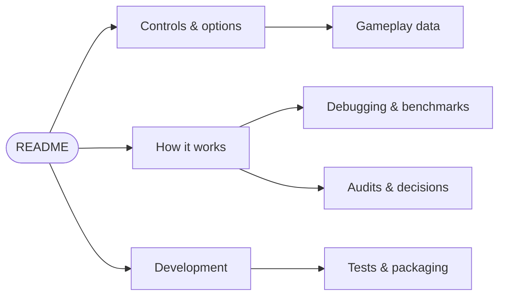

# Documentation

The [root README](../README.md) is the front door: what Knightrock is, how to
launch it, and where the quality gates live. This folder is the deep end — pick a
subject below and follow it as far as you need.

## At a glance

| Capability | What it does |
|---|---|
| **Hack 'n' slash combat** | No More Heroes 2 in 2D: high and low slashes and guards, a rechargeable blade battery, beats, throws, death blows on a direction prompt, a slot machine and a fury gauge that opens the dark side. Frame data has startup / active / recovery phases and multi-hitbox attacks. |
| **Deterministic physics** | Fixed 60 Hz simulation, sub-stepped swept collisions, moving and one-way platforms, spatial hashing. |
| **Data-driven values** | Attacks, enemies, the player and the level registry live in tracked JSON under `data/gameplay/`. |
| **Scene stack** | Menu, level select, options, video, controls, gameplay, pause, game-over and victory scenes over a synchronous, ordered [event bus](architecture.md#architecture). |
| **Interface sounds** | One bus owns `pygame.mixer` and answers facts from the event bus (navigate, confirm, back). No screen names a cue or a file; silent and non-fatal without a sound card. |
| **Debug test bench** | Hotkeys to spawn foes, fire pooled projectiles and force showcase attacks, without recompiling. |
| **Quality gates** | 3841 tests, strict mypy and Ruff (lint, format, `C901`), all blocking in CI. |

## Where to go

### Using and tuning the game

- [Controls and options](controls.md) — every keyboard, mouse and gamepad binding,
  the direction prompts, and which settings screen owns each choice.
- [Data-driven gameplay](data.md) — the tracked JSON files, how they load, and the
  in-code fallback.

### Understanding the code

- [Architecture and rendering](architecture.md) — framing, camera rounding,
  culling, physics, combat, draw planes, and the scene/event-bus architecture.
- [Debugging](debugging.md) — the `DEBUG=1` test bench and overlay, and what each
  diagnostic layer costs.
- [Benchmarks](benchmarks.md) — the standalone measurement scripts, including the
  optional mypyc A/B.

### Working on the project

- [Development](development.md) — a module-by-module reading map, conventions and
  further notes.
- [Tests and quality](testing.md) — how to run the gates and what they protect.
- [Packaging and releases](packaging.md) — the PyInstaller spec and the release flow.

### History and decisions

- [audit/](audit/) — performance and refactor audits, the Phase E plan, and the
  measurements behind the optional optimizations.
- [Playtest notes](playtest-2026-11-18.md) — combat feel observations from
  November 2026.
- [Hitbox fluidity PR notes](pr-fix-hitbox-fluidity.md) — the reasoning behind the
  hitbox feel fix.
