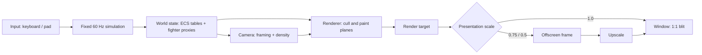
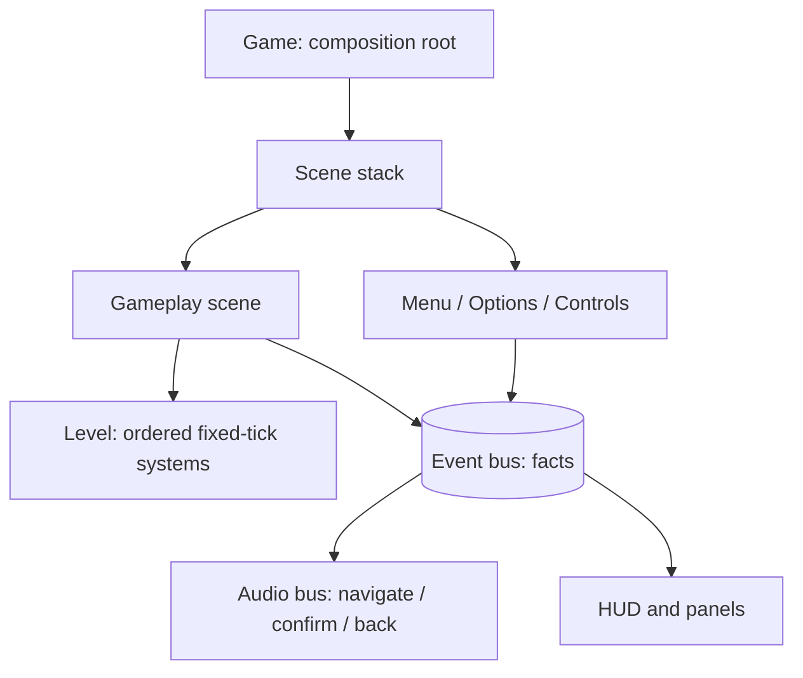

# Architecture and rendering

> **In one sentence:** the simulation runs at a fixed 60 Hz in world units; the
> renderer paints one frame into a target derived from the window; `Presentation`
> puts that target on screen, optionally from a smaller internal frame.

## The frame at a glance



> **Read this first:** the simulation never sees a window, a DPI or a render
> scale. Everything display-related lives to the right of the camera.

**On this page:** [rendering model](#rendering-model) ·
[framing](#framing) · [displays](#displays) · [window](#the-window-is-the-target) ·
[camera and culling](#camera-rounding-and-culling) ·
[physics](#physics-and-assists) · [combat](#combat-and-knockback) ·
[draw planes](#draw-planes) · [code layout](#architecture)

## Rendering model

### Framing

> **The camera shows a fixed rectangle of the world: 1152×648 world units**
> (`src/core/display/framing.py`). It is render-only, and **the simulation reads
> it and nothing else** — window size, DPI and desktop dimensions
> are not observable from it.

It is deliberately tight: the player sees 45 % of the width and 34 % of the
height of the shipped level, so a level has to be read as it is entered rather
than mapped from the menu.

| Object | What it is |
|---|---|
| `Framing` | the visible rectangle of the world, in world units. Fixed. |
| `Viewport` | the surface everything is drawn into: the window's fitted rect |
| `Stage` | the OS window: size, monitor, DPI, vsync |
| `Presentation` | window onto target, and the pointer back. At a reduced render scale it upscales the finished frame to the window. |
| `monitors` | what this machine has, and which panel holds the window |
| `sdl_probe` | the libSDL2 pygame already links, for what pygame cannot say |

**Drawing scale comes from the window, not the camera.** A world unit gets
`window / framing` pixels — 1.667 at 1920×1080, 0.694 at 800×600. Art is magnified
once at load; the camera has no zoom, only a density read off the target.

### Displays

- pygame-ce reports display **sizes** only. `src/core/display/sdl_probe.py` reads
  the bundled SDL2 through `ctypes` for each screen's bounds, usable area,
  platform name, refresh rate and compositor scale.
- The probe is cross-checked against pygame's numbers and discarded if they
  disagree: a second libSDL2 can answer plausibly while never initialised.
- Without the probe, the game falls back to what pygame can say.

```
pygame  SDL_GetDesktopSizes()          -> [(1920, 1080)]
SDL     SDL_GetDisplayBounds(0)        -> (0, 0, 1920, 1080)
SDL     SDL_GetDisplayUsableBounds(0)  -> (0, 32, 1920, 1048)
SDL     SDL_GetDisplayName(0)          -> b'eDP-1 17"'
```

### The window is the target

No display mode, exclusive fullscreen, borderless or screen picker. Three rules:

1. **Size is a request.** The window opens on the screen it last closed on (or the
   primary), at the player's chosen size or the largest that fits, then the player
   drags it. The screen is remembered by name; position belongs to the window
   manager.
2. **The target is the window's fitted rectangle** at scale 1.0; the frame is
   blitted 1:1. A reduced internal scale draws offscreen and upscales once — off
   by default here because the CPU copy costs more than it saves.
3. **Fit is a choice**: bars, whole-pixel blocks, or zoom with a crop. All show at
   most the framing; the HUD is laid out in the visible part (`Game.shown_area`).

Resizing rebuilds the target, re-reads density and re-lays out the interface: one
cascade shared with a window rebuild. **It never changes how much world is seen.**

- The size is **polled from the window**, not from an event: one SDL resize becomes
  seven pygame events and the carrier depends on platform and gesture.
- The frame in which the size changed re-lays out the interface **before** input
  is read. Without that, a click was converted through the new picture and tested
  against the old rectangles — measured 244 px off.
- `reset_cache` drops the rectangles for a change the game makes while handling
  input, with another input already queued.

The **VSync row** reports the screen the window is actually on, found from its
position. If it cannot be established the row says nothing. Display hot-plug is
polled on a timer; a window whose screen disappears is rebuilt on the primary.

<details>
<summary><b>Why size is a request and framing is not derived from the window</b></summary>

- A hardcoded size list claims things about a monitor the game cannot check
  (e.g. 2560×1440 on a 1366×768 laptop). Offered sizes are derived from the
  current panel and filtered to what it holds.
- A saved size is honoured where it fits and clamped where it does not; the file
  keeps what the player chose. The old `width`/`height` keys were overwritten at
  launch, so a size never survived a change of machine.
- The framing used to be built from window pixels and a zoom constant, making the
  visible world a video setting: the reveal ran from 34 % to 60 % of a level's
  height, and a large preset showed a whole 40×15 level. It is now fixed.

Two tests pin it:

- `tests/unit/test_framing_contract.py` — framing is smaller than every level;
- `tests/unit/test_sim_is_display_independent.py` — one input log, five window
  sizes and five densities, same world checksum.

</details>

<details>
<summary><b>Measured: 1:1 present vs <code>smoothscale</code></b></summary>

| Window | 1:1 | `smoothscale` |
|---|---|---|
| 1280×720 | ~0.38 ms | ~3.95 ms |
| 2560×1440 | ~1.33 ms | ~7.46 ms |

</details>


<details>
<summary><b>Measured: presenting 1:1 versus <code>smoothscale</code></b></summary>

Presenting the finished frame with a 1:1 copy, against resampling it to the same
target with `pygame.transform.smoothscale`:

| Window | 1:1 present | `smoothscale` |
|---|---|---|
| 1280×720 | ~0.38 ms | ~3.95 ms |
| 2560×1440 | ~1.33 ms | ~7.46 ms |

</details>

### Camera, rounding and culling

- `Camera.apply()` maps a world rectangle to exact target coordinates —
  `screen = (world - offset) * density`. Sprites, health bars, hitboxes, labels
  and the debug overlays all read the one transform, so none of them can drift
  from the others.
- `Camera.scaled_size()` is the **single rounding rule** in the drawing path: an
  image is magnified to that size and blitted into a rectangle of that size.
- `Camera.is_visible()` culls against the framing rect, and the frozen terrain is
  narrowed to a handful of chunks before it gets there.
- Every frame is a complete repaint of the target, so a stale pixel is not
  possible rather than merely unlikely.
- A frame drawn between two ticks blends the camera *and* the fighters by the
  same `alpha`: each fighter is drawn between where the last tick began and
  where it ended (`RenderHints.previous_center`, written at the top of every
  tick, frozen ones included). A move longer than `Interpolation.MAX_STEP_PX`
  is a teleport and is drawn where it lands. Health bars follow the drawn
  fighter. `Interpolation.ENABLED = False` turns it off.

<details>
<summary><b>Why the rounding rule is asymmetric</b></summary>

`Camera.apply_snapped()` rounds position **down** and size **up**. That is what
makes a run of tiles overlap by at most a pixel instead of drifting apart by one
every few tiles and opening a line of background through the terrain.

It is a real defect rather than a cosmetic one because `pygame.blit` silently
resamples a source that does not fit its destination. Fuzzing every framing,
density, offset and rect finds no gap and no resample.

</details>

### Physics and assists

Assists are **on**. Set a value to `0` (or `1` for the jump cut) to restore the
legacy, assist-free behaviour. All of them live in `src/core/settings.py`.

| Class | Constant | Effect |
|---|---|---|
| `GameFeel` | `JUMP_CUT_DIVISOR` | Variable jump height — releasing the button cuts the rise. |
| `GameFeel` | `GROUND_SNAP_PX` | Sticks to the ground instead of floating off platform edges. |
| `GameFeel` | `STEP_UP_PX` / `CORNER_CORRECT_PX` | Auto-mounts small steps, nudges around ceiling corners. |
| `GameFeel` | `APEX_GRAVITY_DIVISOR` | Reduced gravity at the jump apex, for a longer hang time. |
| `GameFeel` | `FAST_FALL_GRAVITY_MULTIPLIER` | Extra fall acceleration while the down key is held. |
| `Collision` | `MIN_PENETRATION_PX` | Grazes keep sliding instead of stopping dead. |
| `Collision` | `MAX_RESOLVE_PX` | Anti-teleport guard; deeper overlaps flag the entity `crushed`. |
| `PlatformRide` | `STICKY_FACTOR` | Stay mounted on fast-descending platforms. |

### Combat and knockback

Combat is frame-data driven: startup / active / recovery phases feed
`HitboxManager` and `HitResolver` through the two-pass deterministic
`CombatSystem` (`src/core/level/systems/combat_system.py`).

| Constant | Effect |
|---|---|
| `Combat.WALL_BOUNCE_FACTOR` | Mid-launch entities rebound off walls (red arrow in debug) instead of stopping dead. |
| `Combat.GROUND_BOUNCE_MIN_SPEED` / `_FACTOR` / `_KEEP` | A launched fighter that lands faster than `MIN_SPEED` rebounds once, keeping `FACTOR` of its fall and `KEEP` of its run. `FACTOR = 0` turns it off. |
| `Combat.KNOCKBACK_MAX_DURATION` | Anti-lock safety for pits. |
| `Physics.REACTION_SLIDE_FRICTION` / `_SLIDE_DRAG` | How a hit fighter slides to a stop on the ground: a constant grip (px/s²) plus a drag (1/s). Shared by hurt, stagger and knockback, so a hit's `power` alone decides how far it sends its target. |
| `Physics.REACTION_AIR_DRAG` | Light horizontal drag while a hit fighter is airborne; `0` keeps the launch speed constant. |
| `Combat.KNOCKBACK_DI_ACCEL` / `_DI_CAP` | Directional influence: an airborne entity can steer its trajectory. |
| `Combat.JUGGLE_DECAY_STEP` / `JUGGLE_DAMAGE_FLOOR` | Diminishing returns on consecutive juggle hits. |
| `Combat.HITSTOP_KNOCKBACK_FACTOR` | Hit-stop scaled to impact magnitude. |
| `Combat.KILL_HITSTOP` / `EXECUTION_HITSTOP` | The least a killing blow, and an execution (a stab, a throw, a death blow), freeze the world. A hit's own `hit_stop` in `attacks.json` replaces the formula: the slash links freeze for two ticks, the finisher for seven. |
| `Combat.OTG_INVULN_DURATION` / `ENEMY_OTG_INVULN_DURATION` | How long a fighter landing from a launch is safe from ground hits: the player is, an enemy is not, so the blow after a launch lands. |
| `Combat.HEAVY_KNOCKBACK_THRESHOLD` | `400` — above it, `CameraShake` is given trauma of `impact / HEAVY_DIV`. |
| `CameraShake.HIT_TRAUMA` / `HIT_DIV` / `KILL_TRAUMA` / `EXECUTION_TRAUMA` | Every landed hit shakes a little, a kill a little more, an execution the most; the strongest of the tick wins. |
| `CameraShake` | `MAX_PX`, `DECAY_PER_S`, `FREQUENCY` — the shake envelope itself. |

Three things decide how far a hit sends its target, and nothing else does:

- the hit's `knockback.power` in `attacks.json` — the speed it gives, in px/s;
- the target's `weight` in `enemies.json` — every knockback it takes is divided
  by it, *before* the launch threshold is read, so one blow launches a slime
  (`0.8`), shoves a goblin (`1.0`) and barely moves a shell (`1.5`);
- the shared friction above (`Physics.REACTION_*`), the same in hurt, stagger
  and knockback.

A hit marked `flinch` in `attacks.json` does not push a grounded target
sideways: the chains' links stun without sending the target out of reach.
An airborne target is pushed as usual, so a juggle still carries.

An enemy the last hit kills leaves the simulation on that tick, and a body in
the FX plane (`CorpseParticle`, tuned by `fx.tuning.Corpse`) carries the hit on:
thrown the way the blow pushed, tumbling, fading. Render-only — it collides with
nothing and no snapshot or golden sees it.

**Enemies choose and take turns.**

- `enemies.json` lists each type's `moves`: an attack, its range and a weight.
- The chase picks one on entry from the enemy's own random stream, so a rollback
  replays the same choice.
- At most `AI.MAX_ATTACKERS` enemies attack at once; the rest wait at striking
  distance, counted from the roster's states rather than stored.
- The goblin and the tooth sweep the floor with a long claw, the slime splashes:
  both can be jumped. The goblin's swipe can meet a slash blade to blade
  (`clash` on both hits).

**A slowed world is the same world on a slower clock.**

- Dark step, prompt and stasis give every entity but the player a share of the
  tick's delta (`Player.world_time_scale`, `PhysicsSystem.process`), including
  platforms, hazards and projectiles. Attacks count frames off that delta, so an
  enemy's swing takes longer.
- Fury, the dark side and blitz do the reverse for the player: the attack clock
  runs fast, and the extra frames go to startup and recovery only. An active
  frame is never skipped — a fast swing hits what a slow one would.

> **Directional influence is not player-gated.** `_apply_directional_influence` in
> `src/states/reaction_states.py` fires for any entity whose `move_axis` is
> non-zero, and enemies do set `move_axis`. In practice a launched enemy rarely
> carries a stale axis into the air, but the gate is "has an axis", not "is the
> player".

### The ground pivot

> **`turn` is a state, not a delayed facing write.** Reversing on the ground used
> to mirror the sprite on the same frame the axis flipped, so a pivot read as a
> teleport. The velocity curve was never the problem — it always took about a
> third of a second to cross zero. The picture refused to show any of it.

- A delayed facing would be a value every interrupter has to undo, and each
  would need to know the rule exists.
- A state is entered and exited instead: an attack, dash or jump taken mid-pivot
  leaves through `PlayerTurnState.exit`, where the facing is finally committed.
- An attack inside the pivot therefore comes out where the player is pointing —
  no special case to remember.

| Constant | Shipped | Effect |
|---|---|---|
| `Turn.DELAY_S` | `0.14` | How long the pivot holds — just under nine ticks at 60 Hz, the length of the plant. |
| `Turn.MIN_SPEED_PX_S` | `30.0` | Below this the fighter is not travelling, so the flip is immediate and no state is entered. |
| `Turn.BRAKE_CONTROL` | `20.0` | Ground braking on a reversal: bleed toward **zero** at this rate. |
| `Turn.PLANT_PX_S` | `20.0` | …then push out of the plant at this speed. |
| `Turn.LEAD_PX` | `32.0` | Render-only trailing offset of the body, shrinking to zero as the facing lands. |
| `Turn.SKEW_PX` | `20.0` | Shears the frame so the feet stay planted and the top of the body leans over. |
| `Turn.STEP_DISTANCE_PX` / `SPREAD` | `40.0` / `1.15` | The pivot's row in `FootstepDust.TIER`. |

**The pivot is registered in every fighter's state machine** under one shared
name (`Turn.STATE`). Activation is decided by **group and sub-group**, not per
entity:

- groups and sub-groups are named profiles in `settings.PROFILES`, layered by
  inheritance;
- every field is optional, and a layer that omits one inherits it.

| Layer | Where it is named | Ships as |
|---|---|---|
| defaults | `settings.Turn` | off |
| group (one per faction) | `PROFILES["player" / "enemy" / "neutral"]` | only the player is on |
| sub-group (one per enemy type) | `EnemyConfig.turn_profile`, i.e. `"turn_profile"` in `enemies.json` | `null` — takes the group |
| the entity | an attribute set in code | wins over all of the above |

<details>
<summary><b>Measured rationale, worked example, and two state details</b></summary>

**Why braking and accelerating are separate.** A single exponential ease toward
the target is symmetric by construction: the same rate bleeds speed off on the way
to a stop as on the way back up to a run. That is right for one and wrong for the
other. A *reversal* is not that — and a symmetric curve never plants, it crosses
zero without dwelling. At `Physics.FLOOR_CONTROL` a full run crosses in under two
frames, so the deceleration existed and was never seen. *"It turns instantly"*
means not that nothing happens but that what happens is over before the eye has it.

- **Brake toward zero, then plant.** From `PLAYER_SPEED`, a full run sheds
  `251 → 180 → 129 → 92 → 66 → 47 → 34 → 24 px/s` over the eight ticks of
  `DELAY_S`, arriving at the flip standing still.
- **Aiming at zero is the part that matters.** The rate only decides how fast the
  bleed is; aiming at the *target* makes the velocity curve pass through the
  crossing at any rate, so the plant never happens.
- **Airborne is untouched** — a mid-air reversal is a jump turn, and the tighter
  air curve is what makes an air dash feel like an air dash.
- **The lean carries the effect, not the slide.** `LEAD_PX` at 32 px is half the
  sprite's width — 5.5 frames of travel, clear and near its ceiling. A lean has no
  such ceiling, because it cannot detach from anything, which is why raising
  `SKEW_PX` paid far more than raising the slide would have.

**Worked example** — *"all the enemies except the slimes"*. Illustrative: the
repository ships the mechanism, not these entries.

```python
# src/core/settings.py — all the enemies take it...
PROFILES["enemy"] = TurnProfile(inherits="default", enabled=True)
# ...except this one, which plants more slowly and leans further.
PROFILES["enemy_goblin"] = TurnProfile(inherits="enemy", brake_control=12.0, skew_px=28.0)
PROFILES["enemy_slime"] = TurnProfile(inherits="enemy", enabled=False)
```

```json
// data/gameplay/enemies.json — which sub-group each type belongs to
{ "goblin": { "turn_profile": "enemy_goblin" } }
```

One entry on for the faction, one off for the type, one string in the type's
config. Nothing in the simulation, the state machine or the renderer knows a
group exists — an entity adopts a name and is done.

- **An unknown profile name is the defaults, not a crash.** A typo gives a fighter
  the shipped behaviour and a game that still starts; a self-inheriting profile
  stops at the cycle rather than hanging at import.
- **The drawing numbers travel with the profile.** `turn_lead_px` and
  `turn_skew_px` live on the entity, not in `settings.Turn`, because the renderer
  is handed a sprite. Left in the settings block they would make a group look
  tunable while the lean quietly ignored it.
- **Per-fighter overrides** win over every named layer: `turn_enabled`,
  `turn_delay_s`, `turn_brake_control`, `turn_plant_px_s`,
  `turn_min_speed_px_s`, `turn_lead_px`, `turn_skew_px`.
- **The hold is installed from the input side.** `PlayerInputHandler` reads input
  in `_pre_update`, *before* the state machine, so a decision taken from a state's
  own `update` would be a frame too late to stop the mirror it is meant to delay.
  `request_turn()` is asked instead of `face_movement()`, and the state keeps the
  mirror frozen with the `facing_locked` tag.
- **The pivot carries the tier it interrupted.** The hold spans the frames where
  the velocity sweeps through `run` / `walk` / `walk_slow`, so resuming from it
  with the live state name would drop `resolve_locomotion_state`'s hysteresis and
  flicker the tier boundaries at the fastest moment.

</details>

### Draw planes

The world is drawn from three **planes**, split by one property: whether the
sprite moves.

| Group | Contents | Culling |
|---|---|---|
| `SpriteGroups.static_sprites` | Background and terrain layers, built once | `TileChunkIndex`, a chunk grid built at load |
| `SpriteGroups.all_sprites` | Everything that moves | Scanned — exact and cheap, tens of sprites |
| `SpriteGroups.fg_sprites` | Foreground tile layers | `TileChunkIndex` |

The split is what makes the index pay:

- Leaving tiles in `all_sprites` would make the renderer walk all 839 of them
  each frame just to discover they were already drawn.
- Measured on level 0: **0.22 ms indexed vs 0.28 ms scanned**; at 22 000 tiles,
  **0.07 ms vs 2.67 ms**.
- Tile layers stay in `collision_sprites`, so physics is untouched.

Anything that genuinely needs the whole world — the debug overlay, the sprite
counter — reads `SpriteGroups.every_sprite`. The index only decides which sprites
are *worth asking about*; `Camera.is_visible` still decides which are drawn, so a
chunk can over-select but never under-select.


## Architecture

Scenes own their lifecycle. A synchronous, ordered event bus publishes **facts**;
systems and the audio bus subscribe without knowing which screen produced them.



```
src/
├── application/   Composition root (game.py), scene stack, save game, settings store
│   └── scenes/    menu · level select · options · video · controls category ·
│                  controls · gameplay · pause · game over · victory
├── combat/        Frame data, hit resolver, knockback, charge and combo
│                  tracking (CombatSystem lives in core/level/systems/)
├── core/          Event bus, settings, paths, colors, object pool,
│                  hazards, sprites, sprite groups, asset library, audio
│   ├── animation/ Animator
│   ├── display/   Framing, letterbox, Viewport, Stage, Presentation, monitors, detection, sdl_probe
│   ├── fx/        Draw, particles, spawners
│   ├── input/     Bindings, providers, managers, input state
│   ├── level/     Level facade + ordered fixed-tick systems
│   ├── rendering/ Camera (fixed framing + a density read off the target),
│   │              renderer, tile chunk index, world-overlay port
│   └── rollback/  Snapshot ring buffer and deterministic restore
├── data/          Strict JSON loaders + in-code fallback values
├── entities/      Entity base, player + controllers, projectiles, vitals,
│                  crouch posture
│   └── enemies/   Data-driven configs, factory, per-type behaviour
├── physics/       Collisions, gravity, movement, spatial hash, entity grid
├── states/        State machines (player, enemies, shared reactions, turn)
└── ui/            Player HUD, panels, world-space debug overlay
                   (dimensions in `world_overlay/metrics.py`, bars in
                   `world_overlay/bars.py`, menus in `metrics.py`)

data/gameplay/     Tracked JSON gameplay values
assets/            TMX levels and sprites — required at runtime
docs/              Audit reports, measurements, open points, design proposals
```

## See also

- [Data-driven gameplay](data.md) — where world values come from.
- [Debugging](debugging.md) — how to inspect the pipeline live.
- [Benchmarks](benchmarks.md) — what each part of the frame costs.
