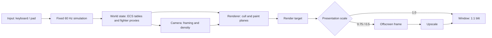
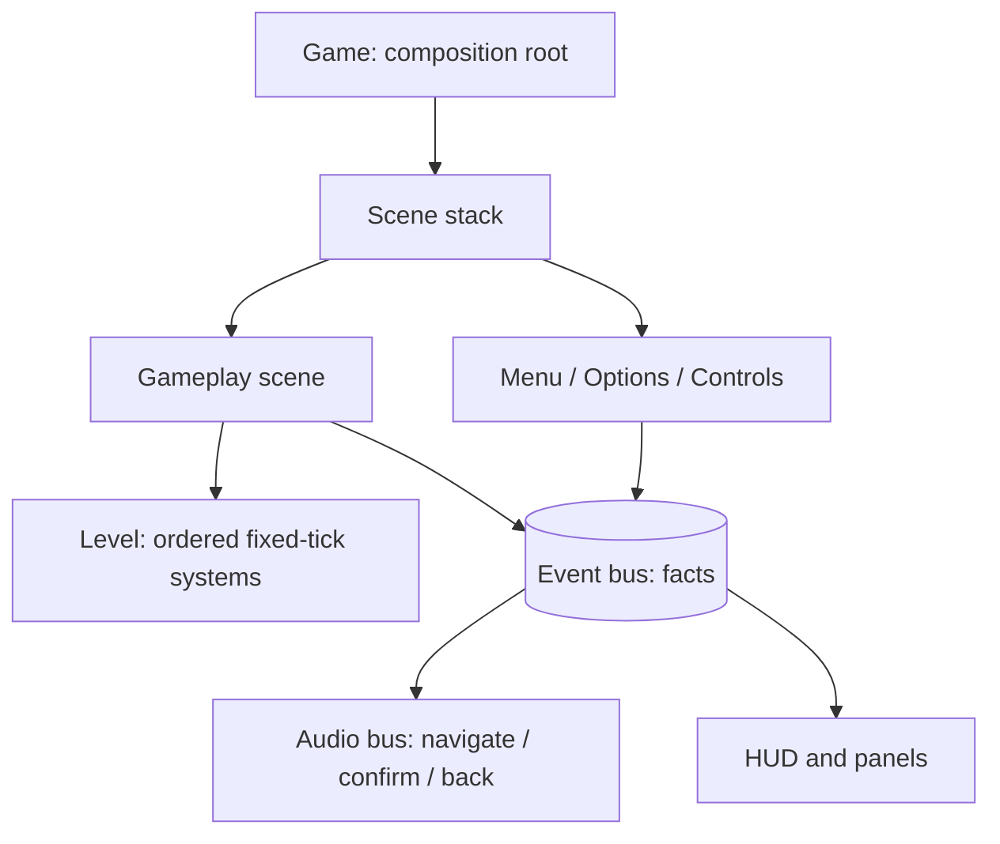

# Architecture overview

[Documentation index](../README.md) - [Rendering pipeline](rendering.md) - [Combat and physics](combat-and-physics.md) - [Repository layout](../reference/repository-layout.md)

> **In one sentence:** the simulation runs at a fixed 60 Hz in world units; the renderer paints one frame into a target derived from the window; `Presentation` puts that target on screen, optionally from a smaller internal frame.

The simulation never sees a window, a DPI or a render scale. Everything display-related lives to the right of the camera.

## On this page

| Topic | Page |
|---|---|
| Framing, displays, window sizing, camera rounding, culling, draw planes | [Rendering pipeline](rendering.md) |
| Physics assists, combat and knockback, the ground pivot | [Combat and physics](combat-and-physics.md) |
| Scene stack, event bus and audio bus | this page |
| Source tree and module ownership | [Repository layout](../reference/repository-layout.md) |

## Scenes and the event bus

Scenes own their lifecycle. A synchronous, ordered event bus publishes **facts**; systems and the audio bus subscribe without knowing which screen produced them.

The bus carries two families of facts: simulation milestones emitted from the fixed tick by a `Level` that holds no reference to the application, and interface feedback emitted by the input dispatcher from what a screen reports. Subscribers never mutate the simulation. The audio bus is the only module that touches `pygame.mixer`, and it imports neither the input router, the menu model, the scenes nor the views.

## Determinism

The simulation is a fixed 60 Hz tick. Collisions are sub-stepped, attack geometry is swept, and moving and one-way platforms use a spatial hash. A frame drawn between two ticks blends the camera and the fighters by the same interpolation alpha; a move longer than `Interpolation.MAX_STEP_PX` is a teleport and is drawn where it lands.

See [Conventions](../reference/conventions.md) for the rules that keep the tick deterministic, and [Tests and quality](../guides/testing.md) for the gates that enforce them.
