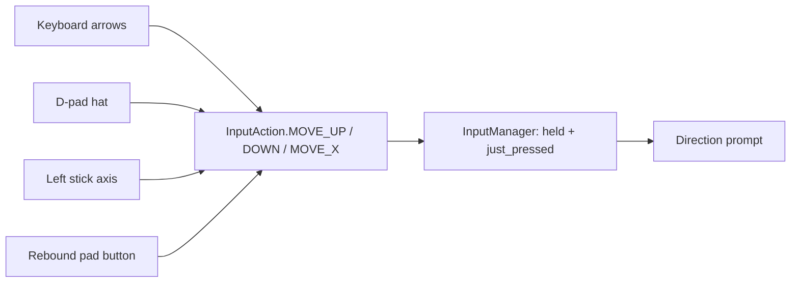

# Controls and options

> **The one rule worth remembering:** a direction prompt accepts **only** a
> direction — arrow key, D-pad, stick, or a button you explicitly rebound to a
> direction. `Space` / `A` is Jump and never answers a prompt. Tap lengths shorter
> than a frame are latched, including during hit-stop.

## Controls

**Keyboard**

| Action | Key |
|---|---|
| Move | `Left arrow` / `Right arrow` |
| Direction prompt (death blow, throw) | `Up` / `Down` / `Left` / `Right arrow` |
| Low stance (ground) / fast fall (air) | `Down arrow` |
| Jump | `Space` |
| Dodge (passes through enemies) | `Left Shift` |
| Guard (held); with Down, recharge the battery | `Q` |
| Reset position (debug builds only) | `R` |
| Slash (hold to charge) | `A` |
| Punch / kick (hold to charge); throw a stunned foe | `S` |
| Shoot (hold to charge) | `D` |
| Dark side (with a full fury gauge) | `G` + `H` |
| Pause / resume | `Esc` / `Enter` |
| Menu navigation | `Enter` / `N` |
| Back in menus | `Esc` / right click |

**Gamepad** — the Xbox One layout, as SDL numbers its buttons

| Action | Button / axis |
|---|---|
| Move | Left stick (axis `0`) or D-pad (`0`) |
| Direction prompt (death blow, throw) | Left stick (axis `1`, up/down) or D-pad (`0`) |
| Low stance / fast fall | Left stick (axis `1`) or D-pad (`0`) |
| Jump | `A` (`0`) |
| Slash (hold to charge) | `X` (`2`) |
| Punch / kick (hold to charge); throw | `Y` (`3`) |
| Shoot (hold to charge) | `B` (`1`) |
| Guard; with Down, recharge | `LB` (`4`) |
| Dark side (with a full fury gauge) | `X` + `Y` |
| Dash | Axis `2` (left trigger on Linux) |
| Reset position (debug builds only) | `View` (`6`) |
| Pause / resume | `Start` (`7`) |
| Menu navigation / confirm | Left stick or D-pad / `A` |
| Back in menus | `B` |

- `B` is **Back** in menus and **Shoot** in game; it never pauses. Pause is
  `Start` on the pad, `Esc` on the keyboard.
- A file still on the old default layout is migrated on read. A custom layout is
  kept, with Reset moved off `Start`; a file from before Shoot gains it on `B`
  and `D` if those are free.
- Axis numbers are the joystick API's and vary by platform: on Windows axis `2`
  is the right stick's X. Dash can be rebound from *Options → Controls*.

Three details of the menu navigation, all in `src/core/settings.py` under
`Input`:

- **A stick is a position, not a press.** A quarter of its travel moves one row;
  pushing further *scrolls*, and easing back stops it without stepping backwards.
- **The D-pad has no partial travel to read**, so holding it scrolls on its own.
- **Only the four directions auto-repeat**, stick and D-pad included — a held
  confirm would otherwise open and close a menu in a loop.

---

**Moves.** Three attack buttons -- the blade, the body and the shot -- the
first two thrown high, or low with Down held, and all three charged when held.
What a press throws depends on what the fighter is doing
(`src/entities/attack_moves.py`, chains in `data/gameplay/attacks.json`):

- **Phase** — one movement: its timing, one hitbox, one effect.
- **Move** — a chain of phases that follow on frame data. A phase may name an
  `auto_into` move: its first phase then follows without input, cooldown or combo
  entry.
- **Combo** — a link *between* moves, opened by `cancel_into` on contact or in
  recovery and chosen by `follow_ups` from the button pressed.
- A phase either strikes or launches a shot, never both.

| Input | Move |
|---|---|
| Slash ×4 | `slash_high_1` cut down → `_2` backhand → `_3` thrust that steps in → `_4` heavy vertical cut (finisher). Down switches any link to its low twin: knee cut, low backhand, low thrust, and a rising cut that launches |
| Slash held | let go early: `charged_slash`, a wide cut that breaks a guard, harder with the time held. Held to the end: `charged_slash_full`, a bigger cut whose last phase continues automatically into `crescent_wave`, which throws the crescent forward |
| Beat ×3 | `punch_1` jab → `punch_2` cross → `punch_3` uppercut (launches); fills the stun gauge |
| Down + beat ×2 | `kick_1` sweep at the ankles → `kick_2` roundhouse that sends the foe into the wall |
| Beat held | `charged_kick`: goes through guards and armour, pushes hard |
| Shoot | `shot`: a short bolt fired from the blade for `Battery.SHOT_COST`; it breaks a wind-up from out of reach |
| Shoot held | `piercing_shot`: a bolt that goes through every guard and every foe on its line |
| Beat on a stunned foe in front, on the ground | the throw: a run of directions, then `throw` |
| Down + slash over a downed foe | `stab`: kills it |
| Slash during a dash, or just after | `dash_slash`: a cut across at full stretch that keeps the dash's speed |
| A slash that would kill | the foe is doomed: one direction, then `death_blow` |
| Slash / beat / shoot in the air | `air_slash` / `air_kick` (dive) / `air_shot` |

### Shape and timing

- **Proportions.** A strike is sized to the drawn fighter (about 24 × 33 inside a
  40 × 56 hitbox): blade ≈28 px from the shoulder, fist ≈22, leg ≈26. Nothing
  reaches past 48 px, swings more than 150°, and high and low blows stay on their
  side of the hips. Two moves of one fighter never share shape, timing, height
  and push (`tests/unit/test_move_proportions.py`).
- **Charge.** With multiplier `m` (1 = released at once, 2 = held to the end):
  damage, push and stun are ×m; shape and reach are
  `1 + Combat.CHARGE_REACH_GAIN × (m − 1)`. A full charge adds its tier's extra
  (crescent, pierce). Charged shots follow the same rule.
- **Blade vs body.** The blade is quicker, longer and pushes little; the body
  starts later, freezes longer on hit, pushes hard, stuns and goes through
  guards (`tests/headless/test_charge_and_buttons.py`).
- **Launched shots.** A phase can fire as it turns active (`launches` in
  `src/entities/shots.py`): bolt, piercing bolt, charged crescent, slime glob.
  The box marks the hand and does not touch; the crescent is its own move,
  reached by `auto_into`.

### Enemies

Each type has its own moves:

- **Goblin** — overhead claw, low claw.
- **Tooth** — bite at the head, snap at the ankles.
- **Shell** — shoulder bash; floor roll that guards cannot stop (jump it).
- **Slime** — slam and a low lobbed glob.

### What is drawn

Render-only cues (`src/core/rendering/strike_trails.py`):

- **Blade** — thin crescent; heavier cuts are wider.
- **Body** — short streak with a knuckle or heel.
- **Charge** — gold, brighter the longer it is held; full is white-hot with
  afterimages. A held charge gathers a closing ring at the hand, flashing full.
- **Death blow** — dark red.
- **Wind-up** — a chevron at the strike height: red, violet if unguardable.
- **Impact** — a marker at the tip: cut for the blade, burst for the body, cut
  and flash for a charged blow; drawn over the struck fighter's flash.
- **Dash** — afterimages spaced by `Afterimage.SPACING`, pale at the back and
  cyan near the fighter; speed lines and a clap of air at the start.
- **Dark step** — violet ring, tinted slowed world.
- **Block** — light shield on the struck side: crescent, brief bubble, sparks;
  gold for a perfect block.

A chain link starts as soon as the previous hit lands; an early press is kept
for `Input.ATTACK_BUFFER_WINDOW`.

### The combat loop

Modelled on No More Heroes 2, in 2D. The tuning lives in `src/core/settings.py`:
`Battery`, `Fury`, `Finisher`, `Throw`, `Clash`, `Slot`, `Stun`, `Rush`, `Guard`.
`Battery`, `Fury`, `Finisher`, `Throw`, `Clash`, `Slot`, `Stun`, `Rush`, `Guard`):

| Mechanic | Rule |
|---|---|
| **Guards** | An enemy that guards (`guards` in `enemies.json`) holds it high or low and switches now and then; a mark on its front edge shows which half. A slash at that height is stopped. Mid-combo it braces: the `Guard.BLOCK_AFTER_HITS`-th blockable blow in a row is stopped at its height, so the same slash mashed stalls. A blocked blow bounces off: the move ends, the player is pushed back (`Guard.DEFLECT_PUSH`), staggers for `Guard.DEFLECT_STAGGER` and pays `Battery.DEFLECT_COST`. The enemy answers with a counter thrown behind the guard until its recovery, which is the opening; a blade that meets the counter bounces off the same way and locks nothing. A punch, a kick or a charged slash breaks the guard for `Guard.BROKEN_TIME`. The player's guard is held and stops everything from the front, for `Battery.GUARD_COST`, except a blow that breaks it. |
| **Battery** | Every slash costs `Battery.SLASH_COST`; on an empty battery a slash does `Battery.EMPTY_POWER` of its damage. Guard + Down recharges it, standing open. |
| **Death blow** | A slash that would kill leaves the foe doomed at `Finisher.DOOM_HEALTH`. The fight slows to `Finisher.TIME_SCALE` and one direction is asked: given in time, the death blow lands, fills fury and spins the slot machine. Missed, the foe gets back up with `Finisher.RECOVER_RATIO` of its health. |
| **Stun and throw** | Beats fill the stun gauge (the strip under an enemy's health bar). A stunned foe in front is grabbed with the beat button: `Throw.STEPS` directions, then the throw, which kills. A wrong one leaves the player open. |
| **Downed** | A launched foe lies on the ground for `Combat.DOWNED_DURATION`; a low slash over it is the stab that ends it. |
| **Blade lock** | Two blades that meet (`clash` on both hits) lock: mash the slash `Clash.PRESSES` times in `Clash.WINDOW` and the foe is thrown off balance (`Clash.WIN_STAGGER`) with its guard down for `Clash.WIN_OPEN` -- an opening, not a stun; lose, and it costs health. A counter never locks (see Guards). |
| **Dash** | One length whatever the stick (about 80 to 105 px): a burst from `Physics.DASH_SPEED` that eases out as `(1 - t)^Physics.DASH_CURVE` to the run speed when the stick holds its way -- so it hands over to the run without a stop -- or to a short glide when it does not. A push the other way in the first `Physics.DASH_REVERSE_WINDOW` turns it round, once, and no ground pivot can cut it short. Untouchable throughout; three charges, and spending the last locks it for `Physics.DASH_PENALTY_TIME`. |
| **Dark step** | A dodge less than `Rush.WINDOW` before a blow lands -- on the player, or on the spot the dodge left -- slows everything but the player for `Rush.DURATION`; slashes are free and fast meanwhile. |
| **Fury** | Filled by landing hits, death blows, throws and dark steps; a hit taken costs `Fury.HURT_LOSS`. Its tiers (`Fury.TIERS`) speed the slashes up -- the HUD combo counter gains a `!` per tier. Full, the chord opens the dark side: `Fury.DARK_DURATION` seconds untouchable, faster, every blow a kill. |
| **Slot machine** | Each death blow spins three reels; three of a kind (`Slot.JACKPOT_CHANCE`) grants a power for `Slot.POWER_DURATION`: stasis (the world slows, every blow kills), blitz (faster, every blow kills) or cleave (slashes `Slot.CLEAVE_MULT` harder). |

During a prompt the player is untouchable and the fight around it nearly
stops. Every `Combat.COMBO_DASH_REFILL_HITS` hits of one combo give a dash
charge back, and a hit landed out of a dodge refunds it.

## In-game options

Options is a **navigation hub**, not a list: every setting lives in the screen
that owns it. Reachable from the main menu and from the pause screen.

| Screen | Owns |
|---|---|
| **Video** | The window's size, how the picture fits the window (bars / whole-pixel / zoom), VSync, frame limit, UI scale, a read-out of what the game derived from the window, and — only under `DEBUG=1` — a debug panel scale. Settings with more than a few values open a **list** rather than cycling on ←/→, and each entry says what it does. |
| **Controls → Menu controls** | Key/button rebinding and the menu stick Y inversion. |
| **Controls → Gameplay controls** | Key/button rebinding. |

Each controls screen ends on a separated, greyed block — the Y inversion,
**Reset to defaults** and **Back**. They are *choices*, not slots, so they carry
no key: a row that looks like the others and cannot take a binding is a row you
press a key on and nothing happens.

Choices are written to `~/.knightrock/settings.json` and apply without
restarting. Each sub-menu has its own **Reset**, restoring exactly what it owns —
the video one leaves your controls alone. A file that cannot be read is reported
in the log with its reason rather than silently replaced, and the file being
overwritten is kept as `settings.json.bak`.

## See also

- [Architecture and rendering](architecture.md) — how input reaches the fixed-tick
  simulation.
- [Debugging](debugging.md) — the F-key bench, including the prompt showcase.
