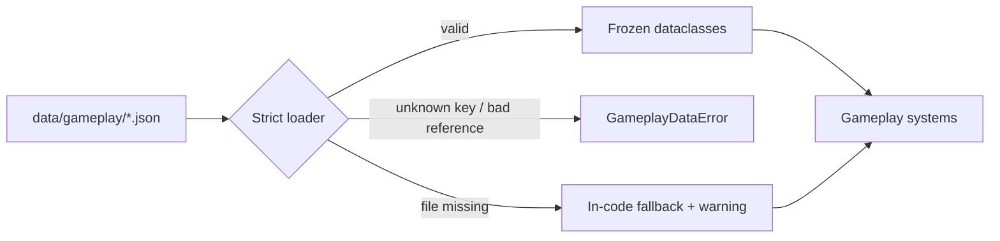

# Data-driven gameplay

Attacks, enemies, the player and the level registry live in **tracked JSON** under
`data/gameplay/`. These files are versioned — unlike `assets/` — so balance changes
are reviewable in a pull request. The frozen dataclasses stay the runtime model.

| File | Contents |
|---|---|
| `attacks.json` | Named attack sets (`player`, `goblin`, `slime`, …) with full frame data. |
| `enemies.json` | Enemy configs, referencing attack sets by name or inlining them; `moves` lists the attacks the AI chooses between, `stun_max` and `stun_duration` are the stun gauge, `guards` whether the type holds a guard. |
| `player.json` | Player overrides plus the name of the attack set to use. |
| `levels.json` | Level id to TMX path mapping. |

Loading is **strict**: unknown keys, missing fields, bad versions and unknown
attack references raise `GameplayDataError`. A *missing* file falls back to the
historical in-code values with a warning, so the game never refuses to boot over a
data problem.

**Environment variables**

| Variable | Purpose |
|---|---|
| `DEBUG=1` | Enable the debug overlay and hotkeys. Same as `main.py --debug`. |
| `KNIGHTROCK_DATA_DIR` | Alternate root containing `gameplay/*.json` (modders, tests). |
| `KNIGHTROCK_EXPORT_DIR` | Destination for `F9` attack exports (default `~/.knightrock/exports/`). |
| `KNIGHTROCK_SAVE_DIR` | Override the save directory (default `~/.knightrock/`). |
| `SDL_VIDEODRIVER=dummy` | Headless rendering (CI, automated tests). |
| `SDL_AUDIODRIVER=dummy` | Headless audio (CI, automated tests). |

## See also

- [Architecture and rendering](../architecture/overview.md) — how these values reach the
  simulation and the renderer.
- [Development](../guides/development.md) — the module map, including `src/data/`.
